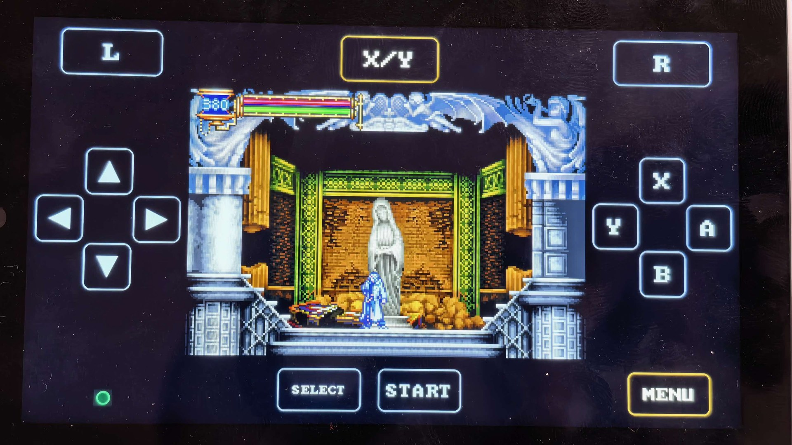

# retro-go Tab5 —— Tab5 上首个满帧 GBA 模拟器（一台机器 11 个机种）

M5Stack Tab5（ESP32-P4，1280x720 原生竖屏）上的复古游戏机固件：**GBA 满帧 60FPS**（RISC-V 动态重编译），
并把 retro-core 的其余 10 个机种一起装进同一个固件 —— GB / GBC / NES / SNES / SMS / Game Gear /
ColecoVision / PC Engine / Lynx / Game & Watch，共 11 个机种。

**v0.4.9 起支持横竖屏切换**：一份镜像同时支持两个方向，首次开机会询问用哪个，之后能在设置里随时改
（选择会保存，改完自动重启生效）。界面为触摸屏重做：游戏画面（720x480 = GBA 240x160 的 3 倍整数缩放）
占满可见区，虚拟手柄画在四周留白处 —— 竖屏时贴顶、手柄在下；横屏时画面居中、手柄在左右两侧。
ROM 直接放 SD 卡（`.zip` 压缩包也能直接放，卡上省一半空间），存档写在卡里、关机重启后还在。



*横屏模式、v0.4.9 构建（2026-10-10 真机拍摄）；当前版本界面与此图一致。*

The first full-speed GBA emulator for the **M5Stack Tab5** (ESP32-P4, 1280x720 native portrait):
GBA at a solid **60 FPS** with a RISC-V dynamic recompiler, plus the 10 other retro-go systems in the
same firmware — GB / GBC / NES / SNES / SMS / Game Gear / ColecoVision / PC Engine / Lynx / Game & Watch.

**Since v0.4.9 the UI runs in either orientation**: one image supports both, the first boot asks which
one you want, and you can change it later in the settings (the choice is saved and the device reboots
into it). The UI is built for a touchscreen: the game screen (720x480, integer 3x of the GBA's 240x160)
fills the visible area and the virtual gamepad is drawn in the margins around it — pinned to the top
with the pad below in portrait, centred with the pad on both sides in landscape. ROMs live on the SD
card (`.zip` works directly, halving card usage) and saves persist across reboots.

---

## 下载与安装 / Download & install

v0.4.9 是**一份构建**，两个渠道各取一个文件即可（不再有"装错的那份只有菜单、进不了游戏"的问题 ——
那来自旧的双 app 形态；现在启动器与全部模拟器核都在同一个 app 里）：

| 安装渠道 | 用哪个文件 | 说明 |
|---|---|---|
| **M5Burner**（推荐）或 esptool | `retro-go-tab5-0.4.9-merged.bin` | 完整镜像（bootloader@0x2000 + 分区表@0x8000 + app@0x10000），从 0x0 整片写入 |
| **[M5Launcher](https://github.com/bmorcelli/Launcher)** | `retro-go-tab5-0.4.9-launcher-singleapp.bin` | 该平台只能装单个 app 镜像；这份就是同一个 app 的纯 app 镜像 |

安装包与校验值见 [`dist/`](dist/)（每个版本一个目录，含 `README_M5Burner.md`、双语说明与封面图）。

**Install channel: one build, two files.** M5Burner / esptool take the *merged* image (written from
0x0, includes the bootloader and partition table); M5Launcher can only install a single app, so it
takes the *single-app* bin. As of v0.4.9 both come from the same build — the launcher and every
emulator core live in one app, so there is no longer a wrong build to install.

> ⚠ 从 0.4.8 升级：本版分区表与 0.4.8 多 app 形态不同（原来的三个 app 槽 → 一个 1984K 大槽）。
> 用 M5Burner / esptool **整包**刷写即可（分区表随之更新）；**不要**只刷 app 分区，旧的 960K 槽装不下。

## 使用 / Usage

- **ROM**：GBA ROM 放 SD 卡的 `roms/gba/`（`.gba` 或 `.zip`，zip 内放一个 ROM）
- **存档**：`retro-go/saves/gba/`，游戏内存档跨重启持久化
- **封面**：可选，`romart/<ROM 文件名>.png`
- **方向**：首次开机询问（横屏 / 竖屏）；之后在 **Options → Screen orientation** 里改，选择会保存并自动重启生效
- **操作**：方向键（竖屏左下 / 横屏左侧）· A/B/X/Y 菱形（竖屏右下 / 横屏右侧）·
  L/R 肩键 · **X/Y ↔ L/R 调换键**（与肩键同排居中，点一下把菱形位与肩键位整对互换，标签随状态变化）·
  SELECT/START（底部中间）· MENU（游戏内菜单）· 电量圆灯（左下角）
- **X/Y 键是连发（turbo）键，但只对 GB / GBC / NES 生效** —— 那三台机器没有肩键也没有第 3/4 个动作键，
  所以 X/Y 被映射成 A/B 连发；GBA 等其余机种上 X/Y 就是独立的 X/Y 按键
- 界面语言默认英文，可在 **Options → Language** 切换中文（设置保存）

详细说明见 [`dist/`](dist/) 里对应版本的 `README_M5Burner.md`。

## 从源码构建 / Building from source

```sh
. tools/idf-env.sh                       # ESP-IDF 5.5.x 环境
cd retro-go-p4

# 发行形态（单 app：启动器 + 全部模拟器核编进同一个 app，支持横竖切换）
RG_TAB5_ORIENTATION=0 python3 rg_tool.py --target tab5 --no-networking --single-app build-img launcher gbsp

# 旧的双 app 形态（菜单与核心各占一个分区；仍在树内保留，供回归对照）
python3 rg_tool.py --target tab5 --no-networking build-img launcher gbsp retro-core
```

产物是 `retro-go_<版本>_tab5-single.img` / `..._tab5.img`（整片合并镜像）；
纯 app 镜像在同一次构建的 `launcher/build/launcher.bin`。
刷机脚本见 `tools/flash-tab5.sh`，单 app 镜像自检见 `tools/check-single-app-image.py`，
免 UI 强制切方向见 `tools/force-orient-nvs.sh`，发布流水线见 `tools/release-tab5.sh`。

> 两种形态由编译期开关 `-DRG_SINGLE_APP=1` 切换。单 app 形态下**屏幕方向是运行时值**：
> 几何、键位表、切换键坐标都按当前方向取值（见 `components/retro-go/targets/tab5/geom.h`），
> 方向真值存在 NVS（`rgapp/orient`），由显示层在初始化时读取。

移植文档、触摸手柄布局模板与踩坑记录见 [`docs/`](docs/)。

## 已知事项 / Known issues

- **横屏的装饰底图仍沿用竖屏风格**（键位与触摸命中区已按横屏重排，属装饰层，后续版本再补）
- 开机瞬间串口上会有一批 `ST7123`（触摸一体屏）I2C 报错，属既有现象，不影响使用
- 没有蓝牙手柄时，触摸手柄是唯一输入源（叠加层强制常显）
- 崩溃时 SD 卡根目录会生成 `crash.log`，反馈问题请带上它

## 许可与致谢 / License & credits

- 本项目基于 [ducalex/retro-go](https://github.com/ducalex/retro-go)（GPLv2）移植；
  GBA 核心为 **[gpSP](https://github.com/libretro/gpsp)**（GPLv2），
  本移植的 RISC-V 动态重编译（dynarec）派生自 **[HowBoyAdvance](https://github.com/Irak4t0n/HowBoyAdvance)**（GPLv2）
  —— 因此整体以 **GPLv2** 发布，见各目录下的 `COPYING`
- 板级支持来自 M5Stack 的 Tab5 BSP（`vendor/m5stack_tab5`）
- Tab5 竖屏/横屏移植、触摸手柄、性能与安装兼容性工作：andjiang
